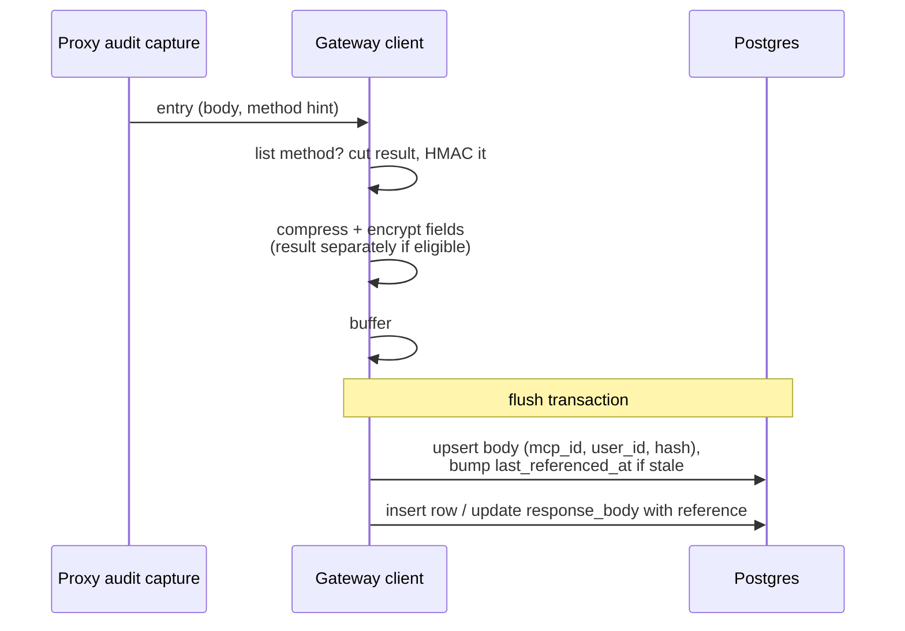

# 2026-11-10: Deduplicate and compress MCP audit log bodies

- **Authors:** @g-linville
- **Created:** 2026-11-10

## Summary

`mcp_audit_logs` is 95–99% of the database in active hosted environments, and
almost all of it is encrypted request and response bodies. Because each body is
encrypted before insert, Postgres can neither compress it nor share identical
copies.

This proposal makes two changes to how MCP audit bodies are stored:

1. **Compress before encrypting.** Every body field, including local-agent
   bodies and raw events, is zstd-compressed and then encrypted. A per-field
   header marks the new format so existing rows keep reading correctly.
2. **Store list responses once.** The `result` of a `tools/list`,
   `prompts/list`, `resources/list`, or `resources/templates/list` response is
   stored once per MCP server and user in a new table, keyed by a keyed hash.
   The audit row keeps the JSON-RPC envelope and a reference. Readers rebuild
   the original bytes.

The API, UI, export, and webhook payloads are unchanged. No backfill is
performed; old rows age out through retention.

## Related issues

- [obot-platform/obot#8418](https://github.com/obot-platform/obot/issues/8418)
  — drives this proposal; this design follows the approach described there.
- [obot-platform/obot#8420](https://github.com/obot-platform/obot/issues/8420)
  — related but separate: local-agent events store each tool response twice.
  That fix is out of scope here and its savings add to these.

## Related ODPs

None.

## Problem and motivation

Measurements from three production environments in November 2026 (from
[#8418](https://github.com/obot-platform/obot/issues/8418)):

| Env | `mcp_audit_logs` size | Rows | Source of bytes (last 30 days) |
|---|---|---|---|
| A | 9.1 GB | 115k | `tools/list`: 4,736 calls, 2.75 GB of 3.4 GB written (~580 KB each) |
| B | 32 GB | 1.7M | `tools/list`: 31k calls, 2.76 GB of ~3.3 GB (~88 KB each) |
| C | 5.3 GB | 8k | local-agent tool-call events: ~2.4 GB a month from one user (~830 KB each) |

Retention defaults to 90 days, so a table settles at roughly three months of
writes. For hosted per-seat pricing, heavy users cost about $3–4 per user per
month in database storage alone.

Postgres cannot reduce this today. `encryptMCPAuditLog` encrypts each body
before insert, so TOAST compression saves nothing, and identical plaintext
produces different ciphertext, so nothing can be shared.

## Goals

- Cut stored bytes for MCP gateway audit workloads substantially. The issue
  estimates about 80%; see [Risks](#risks-and-open-questions) for what that
  depends on.
- The API, UI, audit log export, and webhooks return the same full bodies as
  today, byte for byte.
- Existing rows keep working with no backfill.
- Encryption at rest is no weaker than today. Installs without encryption
  configured still work.
- Retention removes stored bodies that no audit row references, safely with
  several replicas writing and cleaning up at once.

## Non-goals

- Backfilling or rewriting existing rows.
- LLM audit logs and egress audit logs. They store bodies the same way and
  could adopt the same field codec later.
- Removing the duplicated local-agent response
  ([#8420](https://github.com/obot-platform/obot/issues/8420)).
- Deduplicating anything other than list-method responses, or sharing stored
  bodies across users or across MCP servers.
- Reclaiming disk space already allocated to the table (see
  [Rollout](#rollout-and-migration)).
- Changing what is captured, the retention period, or moving bodies out of
  Postgres.

## Context and constraints

Facts about the current implementation that shape the design:

- **Body columns.** `MCPAuditLogFields` has `RequestBody`,
  `MutatedRequestBody`, `ResponseBody`, and `OriginalResponseBody`;
  `LocalAgentToolCallAuditLogFields` has `RequestBody`, `ResponseBody`, and
  `RawEvent`. All are `json.RawMessage`, stored as `bytea` on Postgres. SQLite
  is also supported.
- **Encryption.** `encryptMCPAuditLog` runs each field through the
  `mcpauditlogs` transformer and base64-encodes the result. The transformer is
  an opaque `value.Transformer` (AWS, GCP, Azure KMS, or a custom config), so
  no raw key is available to application code. The authenticated context is
  `mcpauditlogs/<mcpID>/<userID>` for MCP rows. A row-level `encrypted` flag
  says whether fields are ciphertext. With no provider configured, fields hold
  raw JSON.
- **The JSON-RPC envelope differs per call.** A stored response is the whole
  message, `{"jsonrpc":"2.0","id":7,"result":{…}}`. The `id` varies, so whole
  bodies are rarely identical even when the `result` is.
- **Two-step writes.** MCP entries are encrypted in `LogMCPAuditEntry`,
  buffered, and flushed in a transaction by `insertMCPAuditLogs`. A response
  often arrives as a separate entry with `CallType: "response"`; persistence
  finds the pending request row (`SELECT … FOR UPDATE`) and sets
  `response_body` with an `UPDATE`. The request row and the response update can
  come from different replicas, and during an upgrade from different versions.
- **Reads.** List queries omit body columns unless payloads are requested.
  `GetMCPAuditLog` (detail view) and `GetMCPAuditLogs` with payloads (API and
  the audit log export controller) decrypt bodies. Search does not look inside
  bodies. Webhook payloads are built at capture time, before persistence.
- **Body sizes.** Request bodies are capped at 10 MiB and a local-agent
  submission at 8 MiB for the whole batch. Response bodies have no reliable
  cap: plain JSON responses are limited to 10 MiB only when hooks run, and the
  audit capture buffers SSE events and hook-less responses without a limit.
- **Properties.** The gateway has a key/value `properties` table.
  `GetOrCreateProperty` encrypts the value with the configured transformer
  and stores plaintext when none is configured.
- **Retention.** Every replica runs `deleteOldMCPAuditLogs` on a timer,
  deleting rows with `created_at` before the cutoff in batches. This is the
  only code that deletes audit rows. `MCPAuditLogRetentionDays = 0` disables
  cleanup.

## Proposed design

### Field format

Each body field carries its own format marker. A row-level marker would not
work: the response `UPDATE` can be written by a different version than the
request `INSERT`.

A new-format field starts with a zero byte, which can never begin valid JSON
or base64, followed by a version and flags:

```text
byte 0   0x00          marker
byte 1   0x01          format version
byte 2   flags         bit 0: zstd-compressed
                       bit 1: encrypted
                       bit 2: reference to a stored body
rest     payload       raw bytes (no base64)
```

- A field without the marker is read exactly as today, using the row's
  `encrypted` flag.
- Writers compress, then encrypt with the existing transformer and the
  existing context, using zstd at its default level.
- A body is compressed only when it is at least 256 bytes and at most 64 MiB,
  and only when the compressed form is smaller. Otherwise the compressed flag
  is unset and the body is stored as is (still encrypted).
- New-format payloads are raw bytes. Today's base64 wrapping adds about 33%
  to every encrypted body for no benefit in a `bytea` column.
- Readers refuse to decompress a field to more than 64 MiB, so a corrupt
  field cannot exhaust memory. Because writers never compress a larger body,
  the cap can never reject a valid field, whatever the capture path produces.
- The format applies to all seven body columns listed above. Headers and the
  encrypted local-agent string fields are small and keep today's format. The
  row's `encrypted` flag keeps its meaning for those.

Exact byte layout is illustrative; the per-field marker, version, and flags
are the design.

### Stored list bodies

A new table holds each distinct list `result` once per MCP server and user:

```text
mcp_audit_log_bodies
  id                  primary key
  mcp_id              text
  user_id             text
  hash                bytea     HMAC-SHA256 of the plaintext result bytes
  body                bytea     field format above (compressed, then encrypted)
  created_at          timestamp
  last_referenced_at  timestamp, indexed
  unique (mcp_id, user_id, hash)
```

- **Scope is per MCP server and user.** The stored body is encrypted with the
  same `mcpauditlogs/<mcpID>/<userID>` context as the rows that reference it,
  so the encryption binding is exactly today's and nothing is shared or
  revealed across users.
- **Eligible bodies.** `ResponseBody` and `OriginalResponseBody` of the four
  list methods, when the body parses as a JSON-RPC success response with a
  `result` of at least 2 KiB. Postgres keeps values below about 2 KB in the
  main row, so a smaller result saves little and the reference still costs a
  hash, an envelope, and an index lookup. Everything else, including error responses
  and bodies that do not parse, is stored inline (compressed).
- **Knowing the method.** A separate response entry does not carry the request
  method. The proxy audit capture, which does know it for the same HTTP
  exchange, passes it as a non-persisted hint. Responses without a hint
  (legacy cross-request correlation) are stored inline.
- **Byte-exact rebuild.** The writer cuts the `result` value's bytes out of
  the body. The audit field becomes a reference record: the hash, the cut
  offset, and the remaining envelope bytes, encoded with the field format and
  the reference flag. The reader splices the stored bytes back at the offset,
  reproducing the original body exactly. No JSON canonicalization is done;
  two results that differ only in formatting are stored separately.
- **Rows reference bodies by hash, not by id**, so a body that is cleaned up
  and later re-created is still found.

### Hash key

The hash is `HMAC-SHA256` under a random 32-byte key. The key is generated on
the first eligible write and stored base64-encoded in the existing
`properties` table through `GetOrCreateProperty`, under a key such as
`mcp-audit-log-body-hash-key`. That path already encrypts the value when a
transformer is configured and stores plaintext otherwise, so encrypted and
unencrypted installs share one code path. Each replica caches the key in
memory.

Two replicas can race on first use: both find no key and both insert, and the
loser fails on the primary key. The caller must retry, and the retry reads the
winner's key. If the key still cannot be loaded, the body is stored inline
rather than dropped.

A keyed hash prevents someone with database access from confirming a guessed
list body. The key is needed only to find an existing copy at write time. If
it is lost or replaced, new writes miss the old copies and store new ones;
reads are unaffected.

### Write path



- The stored-body upsert and the audit row write happen in the same
  transaction, so a committed row never references a body that was not
  written.
- The upsert is `INSERT … ON CONFLICT (mcp_id, user_id, hash) DO UPDATE SET
  last_referenced_at = …`, applied only when the body is absent or its
  `last_referenced_at` is more than a day old. A fresh existing body costs one
  indexed lookup and no write.
- A small in-process cache of recently confirmed keys lets a replica skip
  compressing and encrypting a result it already knows is stored. On a cache
  miss that turns out to be a conflict, the extra work is discarded.

### Read path

- Fields are decoded by marker: old-format fields as today; new-format fields
  are decrypted (if flagged), then decompressed (if flagged).
- For reference fields, the reader collects the distinct `(mcp_id, user_id,
  hash)` keys in the page, fetches them in one query, and splices each result
  into its envelope. A page of identical `tools/list` rows fetches one body.
- Queries that omit body columns (list views without payloads) never touch
  the new table.
- **Failures.** If a field or its stored body is missing, or fails to decrypt
  or decompress, the reader returns the row with its metadata, omits that
  body, lists it in a new `unavailablePayloads` field, and logs an error. One
  bad row does not fail a list page or an export run.
- **`unavailablePayloads`** is an additive string list on `AuditLogDetails`,
  next to `payloadRedacted`, naming each body that could not be read, for
  example `["response.body", "rawEvent"]`. It is omitted when empty. It sits
  on `AuditLogDetails` rather than `AuditLogPayloadDetails` so one list also
  covers `rawEvent`. The same type backs the JSONL export. The UI shows a
  notice in the detail view when the list is non-empty.
- Old-format decrypt errors keep today's behavior unless reviewers prefer to
  align them.

### Retention cleanup

After deleting expired audit rows, each replica deletes stored bodies whose
`last_referenced_at` is older than the retention cutoff minus a two-day
margin, in batches.

Why this is safe without counting references:

- Retention is the only thing that deletes audit rows, and it deletes by
  `created_at`.
- A row is always written at or after its `created_at`, and the write leaves
  the body's `last_referenced_at` no more than a day older than the write.
- So any surviving row (`created_at` ≥ cutoff) references a body whose
  `last_referenced_at` is within a day of the cutoff or newer, which the
  margin keeps. The second day of margin absorbs clock skew between replicas.

Concurrent writers and cleaners: a body old enough to delete is also stale,
so a writer referencing it must bump it. Either the delete commits first and
the writer's upsert re-inserts the body, or the writer's update holds the row
lock, and the delete re-checks its condition after the lock is released and
skips the row (Postgres `READ COMMITTED`). SQLite has a single writer.

If retention is disabled, stored bodies are never deleted, matching audit
rows.

## Alternatives considered

### Status quo, or shorter retention

Costs keep scaling with `tools/list` traffic. Shortening retention reduces
audit value and only scales the problem down.

### Rely on Postgres compression

Would require storing bodies unencrypted, or encrypting below the database.
That weakens the at-rest guarantee for installs that configured a KMS
provider and still stores every copy.

### Deterministic (convergent) encryption

Encrypting identical plaintext to identical ciphertext would let equal bodies
be detected, but Postgres still would not share TOAST values between rows, and
the KMS-backed transformers do not offer it.

### Share stored bodies per MCP server, or globally

One copy per server (or per install) regardless of user saves more when many
users call the same server. Rejected: the stored body could no longer be bound
to the user in the encryption context, and equality of list results across
users would become visible in the database. Per server and user keeps today's
binding exactly.

### Deduplicate any large response

Hashing every response over a size threshold would catch repeats that have not
been measured, at the cost of hashing and looking up many unique tool-call
bodies and placing their content in the shared table. The measured bytes are
in list responses.

### Reference counts, or sweeping for orphans

Reference counts are exact but every batched retention delete must group and
decrement, and a missed decrement leaks a body permanently. A periodic
`NOT EXISTS` sweep needs an index on the reference and scans a very large
table. The last-referenced timestamp needs neither.

### Row-level format column

Simpler to inspect, but wrong when the request insert and the response update
come from different versions.

### Staged rollout (read support one release before writes) or a write flag

Either would avoid the upgrade window described under
[Rollout](#rollout-and-migration). Not selected: the proposal ships reading
and writing together, on by default, with no setting, and accepts that window.

## Trade-offs

- **Simpler rows, more moving parts.** A second table, a stored secret, a
  field codec, and a cleanup invariant replace "one row holds everything".
- **Reads of deduplicated rows need a second query.** Batched per page, and
  only when payloads are requested.
- **Per-user scope trades savings for isolation.** A server with many users
  who each list tools rarely stores one copy per user per distinct result.
- **Bodies are no longer inspectable with plain SQL** on unencrypted installs;
  compressed fields need the application (or a small tool) to read.
- **Compress-then-encrypt makes ciphertext length depend on content.** This
  is data at rest with no attacker-chosen plaintext alongside secrets, so the
  practical exposure is that sizes hint at compressibility.
- **A reference reveals equality within one server and user**: someone with
  database access can see that a user's tool list did not change between
  calls, but not what it was.
- **CPU.** Compression and HMAC are added to the capture path. Expected to be
  small relative to encryption and the proxy round trip; the benchmark
  reports it.

## Risks and open questions

- **Savings depend on calls per server and user.** The 80% estimate in the
  issue was not tied to a dedup scope. Before implementation, measure in the
  three environments how many `tools/list` calls there are per distinct
  `(mcp_id, user_id)`. Compression alone still applies to every stored copy.
  Owner: @g-linville.
- **Results that differ on every call** (timestamps, ordering, pagination
  cursors in `result`) defeat dedup for that server. Compression still
  applies. Worth sampling real responses.
- **Local-agent compression ratio is unmeasured** (environment C). To be
  measured with the benchmark and real samples.
- **Upgrade window.** See [Rollout](#rollout-and-migration). Accepted, but
  should be called out in release notes.
- **Cleanup invariant depends on retention being the only deleter** of audit
  rows and on `created_at` not being later than the write. Any future delete
  path or backdated import must preserve it, or bodies may outlive their rows
  (a leak, not data loss). The reverse failure, a row outliving its body,
  requires clock skew beyond the margin.
- **Thresholds are starting values.** The 256-byte compression floor, the
  2 KiB dedup floor, and the default zstd level are fixed constants, not
  settings. A quick check on a small JSON sample put zstd's break-even between
  64 and 128 bytes, with about 40% saved at 256 bytes. The benchmark on
  realistic bodies confirms or adjusts them before merge of the
  implementation.
- **Response capture is unbounded today** (see
  [Context](#context-and-constraints)). This proposal does not change that. A
  response over 64 MiB is stored uncompressed, as it is now.

## Rollout and migration

- **Schema.** One new table and index through the existing auto-migration.
  No change to `mcp_audit_logs` columns.
- **One release, on by default, no setting.** Readers and writers ship
  together.
- **No backfill.** Old rows stay in the old format and expire through
  retention. Storage for existing environments falls over the retention
  period (90 days by default).
- **Rolling upgrade.** New replicas read both formats. Old replicas cannot
  read fields written by new replicas: until every replica is upgraded,
  requests for payloads that hit an old replica fail for new rows. Metadata
  list views are unaffected, and nothing is lost.
- **Rollback.** Rolling back leaves rows written in the meantime unreadable
  (payloads only) until the upgrade is reapplied. The stored data remains
  intact.
- **Disk space.** Postgres reuses space freed by retention but does not
  return it to the operating system. Existing tables stop growing and then
  hold steady at their current allocation unless an operator runs
  `VACUUM FULL` or `pg_repack`. Whether hosted does this is an operations
  decision outside this proposal.
- **Observability.** Log errors for unavailable bodies. Validate impact with
  table and TOAST sizes for `mcp_audit_logs` and `mcp_audit_log_bodies` before
  and after, in the three measured environments.

## Testing and validation

Unit tests:

- Write and read round trip for every body field, encrypted and unencrypted.
- Two identical `tools/list` results with different JSON-RPC ids are stored
  once and each row reads back byte-identical to its original body.
- The same result for two users, or two servers, is stored separately.
- Reading rows in the old format, and rows mixing old and new fields (old
  request, new response).
- Non-list methods, error responses, unparseable bodies, and responses
  without a method hint are stored inline.
- Missing or corrupt stored body returns the row with the body flagged.
- Cleanup deletes bodies nothing references and keeps bodies referenced by
  surviving rows, including at the margin.
- Loss of the hash key causes a new copy, not a read failure.

Integration tests (Postgres):

- A writer referencing a stale body concurrently with cleanup never commits a
  row whose body is missing.
- Several writers inserting the same new body concurrently produce one row.

Benchmark:

- Bytes stored for N repeated ~500 KB `tools/list` responses, before and
  after, and CPU time per entry.
- Compression ratio and CPU time for representative local-agent events.

## References

- [obot-platform/obot#8418](https://github.com/obot-platform/obot/issues/8418)
- [obot-platform/obot#8420](https://github.com/obot-platform/obot/issues/8420)
- Capture: `pkg/api/handlers/mcpgateway/proxy_audit.go`
- Write, encryption, read: `pkg/gateway/client/mcpauditlog.go`,
  `pkg/gateway/client/auditlogpersister.go`
- Retention: `pkg/gateway/client/retention.go`
- Types: `pkg/gateway/types/mcpauditlog.go`, `pkg/mcp/auditlogs/auditlog.go`
- Migrations: `pkg/gateway/db`
